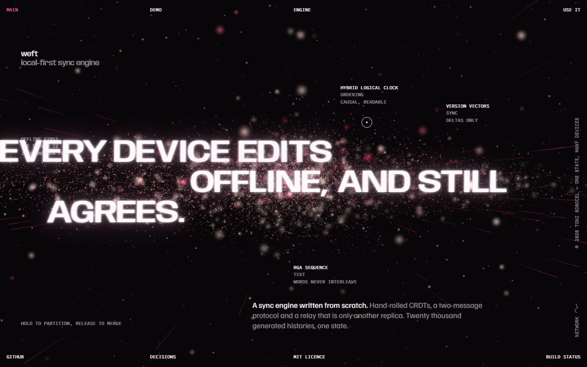
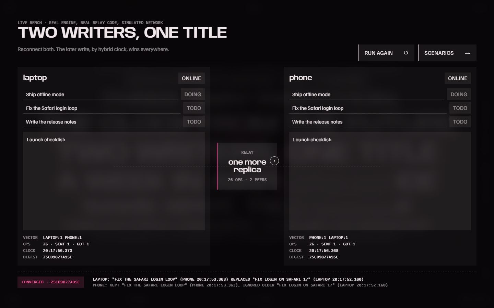
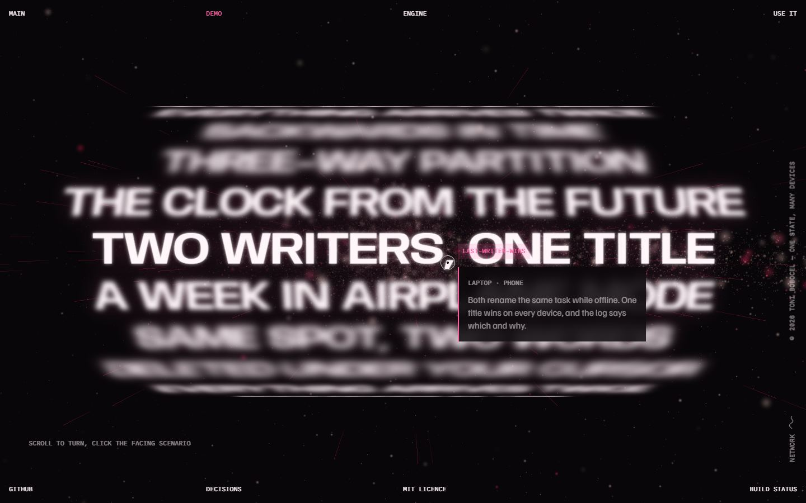

# Weft

A local-first sync engine, written from scratch. Devices edit offline,
exchange only what the others lack, and end up byte-identical, whatever
order the network delivered things in.

[Live demo](https://toni-bobocel.github.io/weft/) ·
[Decisions](docs/adr) ·
[Convergence tests](packages/engine/test/convergence.test.ts)



## What it is

|                   |                                                                                                                                                |
| ----------------- | ---------------------------------------------------------------------------------------------------------------------------------------------- |
| `packages/engine` | Hybrid logical clock, LWW records, RGA text, version vectors, a causal buffer, the protocol. No dependencies; runs in the browser and on Node. |
| `apps/relay`      | WebSocket relay that persists the op log in SQLite. It is a replica that never edits.                                                          |
| `apps/site`       | The demo: a live bench where the engine and the relay's own code run over a simulated network you can break.                                   |

## The claim, and how it is checked

> Whatever each replica did, and however the network delivered it, once
> every replica has seen every op they hold identical state.

`convergence.test.ts` generates histories with fast-check: three replicas
editing records and a shared text, wall clocks that jump backwards, and
deliveries that drop, duplicate and reorder ops. After a final exchange it
requires equal digests, which cover values, timestamps and tombstones, not
just the visible text. 1,500 histories per local run, 15,000 in CI, 20,000
verified while building it. On its second run it found a real bug: reading
a document created an empty one and changed the digest.

A second property checks that with a single writer the text behaves exactly
like a JavaScript string.



## How it works

**Ordering.** Every op is stamped by a hybrid logical clock: physical time
when clocks agree, a counter when they do not, the node id last. If A
happened before B, `ts(A) < ts(B)` regardless of wall clocks. Timestamps
encode to fixed-width base 36, so ids sort as strings.
[ADR 2](docs/adr/0002-hybrid-logical-clocks.md)

**Fields.** Last writer wins, per field, by HLC. When a remote write meets
an existing value the engine reports whether it _replaced_ it (an update)
or was _ignored_ as older (a concurrent loser), which is what the demo's
journal prints.

**Text.** An RGA: each character records the id of the one it was typed
after; siblings sort newest first. Because ids follow causality, words typed
at the same spot on two devices land whole, never interleaved, and a letter
typed into a word someone else deleted survives on its tombstone.
[ADR 3](docs/adr/0003-rga-for-text.md)

**Sync.** Ops carry a gapless sequence number per site, so a version vector
describes exactly what a replica holds. The protocol is two messages:
`hello` with a vector, answered by the ops the sender lacks; then live
pushes. Duplicates are dropped, gaps and missing anchors wait in a buffer.
[ADR 4](docs/adr/0004-op-log-and-version-vectors.md)

**Relay.** A replica that answers deltas, persists the log, and forwards
what it learns. Peers more than 60 seconds ahead are disconnected with close
code 4400 before they can win every conflict for an hour.

## Run it

```sh
pnpm install
pnpm test                               # engine + relay
WEFT_RUNS=20000 pnpm --filter @weft/engine test
pnpm --filter @weft/relay dev           # ws://localhost:8790
pnpm --filter @weft/site dev            # the demo
```

```ts
import { peer, Replica } from '@weft/engine'

const replica = new Replica(deviceId)
const ws = new WebSocket('ws://localhost:8790')
const link = peer(replica, (m) => ws.send(JSON.stringify(m)))
ws.onopen = () => link.open()
ws.onmessage = (e) => link.receive(JSON.parse(e.data))

replica.set('task-42', 'status', 'done')
replica.insertText('note', 0, 'hello')
```

## Trade-offs I took on purpose

- **Own CRDTs, not Yjs or Automerge.** Every merge decision is inspectable,
  at the cost of rich text, moves and cross-peer undo.
  [ADR 1](docs/adr/0001-own-the-crdt.md)
- **Tombstones are never collected.** Safe collection needs proof that every
  replica saw the delete; deferred until a document is actually heavy.
- **Linear-scan RGA.** Fine for notes and descriptions; a 100k-character
  document wants a tree.
- **No authorization on the relay.** A deployment scopes a relay per
  document and checks a token on upgrade.
- **"Last" is by HLC.** Two edits milliseconds apart on two devices are a
  coin toss, but the same coin toss everywhere.



## Layout

```
packages/engine/   hlc, lww, rga, replica, protocol, property tests
apps/relay/        websocket server, sqlite store, socket tests, Dockerfile
apps/site/         demo (Astro, three.js, GSAP)
docs/adr/          architecture decision records
```

## License

MIT
